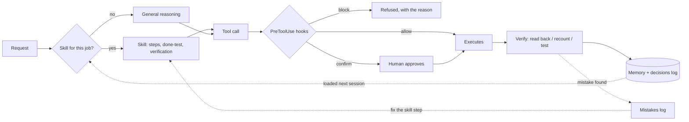

# agent-ops-harness

**A small, working showcase of the pattern I use to run real business operations on Claude Code safely.**

I run two companies, client work and a day job on a much larger private version of this harness. It has been used across 700+ working sessions. Examples:

- Directing the full build of a paid SaaS product ([Tabor8](https://tabor8.com): Next.js, Supabase, Cloudflare R2, Modal GPU, Stripe)
- Managing a client's Google Ads account through the API: weekly reports, and backtesting changes on past data before they go live
- Building and running two client websites and their email, social and ad campaigns
- Automating weekly operational reporting at a polytechnic

This repo is a clean-room sample of the *pattern*. It is not the production system. Everything here is generic and written for this repo.

> I am an AI-directed engineer: I design, specify, review and verify. Claude writes the code.

---

## The problem

An AI agent that only has tool access is capable but unreliable in operations:

| Failure | What it looks like in practice |
|---|---|
| Forgets | Re-asks the same questions every session; loses decisions made last week |
| Overreaches | Runs a destructive command, pushes to production, or sends an email nobody approved |
| Drifts | Does a recurring job differently each time, so numbers stop being comparable |
| Repeats mistakes | Gets corrected, then makes the same error three sessions later |
| Over-claims | Says "done" or "verified" when nothing was actually checked |

Telling the model to behave better in a prompt does not fix these. **Structure** does.

## The pattern



| Layer | What it does | In this repo |
|---|---|---|
| **Skills** | One file per recurring job: when it applies, the steps, what "done" means, how to verify. The job runs the same way every time. | [`.claude/skills/weekly-ads-report/SKILL.md`](.claude/skills/weekly-ads-report/SKILL.md) |
| **Hooks** | Code that runs *before* every tool call. It enforces rules at the moment of action, so the model can't argue or forget its way past them. | [`.claude/hooks/`](.claude/hooks/) |
| **Action rules** | Declarative rules (tool + pattern -> block or confirm), so a new guard is one JSON entry, not new code. | [`action-rules.json`](.claude/hooks/action-rules.json) |
| **Memory** | Small, typed facts with a one-line index loaded each session. Facts recalled from memory are treated as claims to re-check, not truth. | [`memory/`](memory/) |
| **Decisions log** | Significant decisions with the alternatives rejected, so settled questions stay settled. | [`docs/decisions-log.md`](docs/decisions-log.md) |
| **Mistakes -> steps** | Every real mistake becomes a fixed step in the skill for that job, not a vague reminder. | [`docs/mistakes-log.md`](docs/mistakes-log.md) |

## Design principles

1. **Enforce at the point of action.** A rule that fires when the tool is called beats a rule the model is supposed to remember.
2. **Fewer rules, higher compliance.** Each always-on rule costs attention. Lessons for one job belong in that job's skill.
3. **Verification is observing, not reading.** "Done" means the changed thing was run, rendered, queried or read back.
4. **The safe branch is the default.** Destructive or outward-facing actions are opt-in, with a human in the loop.
5. **Every guard gets a negative test.** If you can't show the guard blocking the bad case, it isn't a guard.

## Try it

Requires Node 18+.

```bash
git clone https://github.com/effective-ai-sil/agent-ops-harness
cd agent-ops-harness
npm test        # runs the hook tests (block, confirm and allow cases)
```

To use the hooks in your own project, copy `.claude/` into it. Claude Code picks up `.claude/settings.json` automatically.

Try asking Claude to `rm -rf build/`, `cat .env` or `git push --force origin main`, and watch the hooks respond.

## What's here

```
.claude/
  settings.json                  hook wiring
  hooks/
    lib.cjs                      shared helpers (read input, block, confirm)
    destructive-guard.cjs        recursive deletes, force pushes, hard resets, unscoped SQL deletes
    secret-guard.cjs             .env / key files / environment dumps
    action-rules.cjs             declarative rule engine
    action-rules.json            example rules: deploys, live ad changes, outbound email
  skills/weekly-ads-report/      example skill with a done-test and verification gates
memory/                          index + example typed memories
docs/                            decisions log and mistakes log formats
test/hooks.test.cjs              negative and positive tests for every guard
```

## What is deliberately not here

The production system's skills, client integrations, data, internal rules and tooling are private. This repo shows how it is shaped and the engineering discipline behind it, without the system itself.

---

Built by **Tony Xia**, [Effective.AI](https://effective-ai.xyz), Hamilton, New Zealand. MIT licensed.
